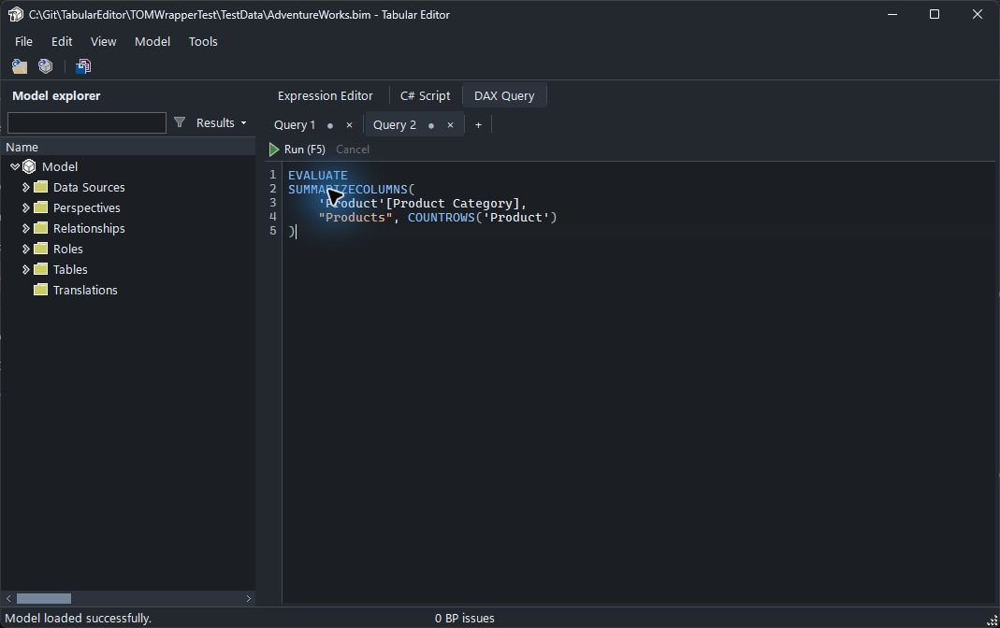
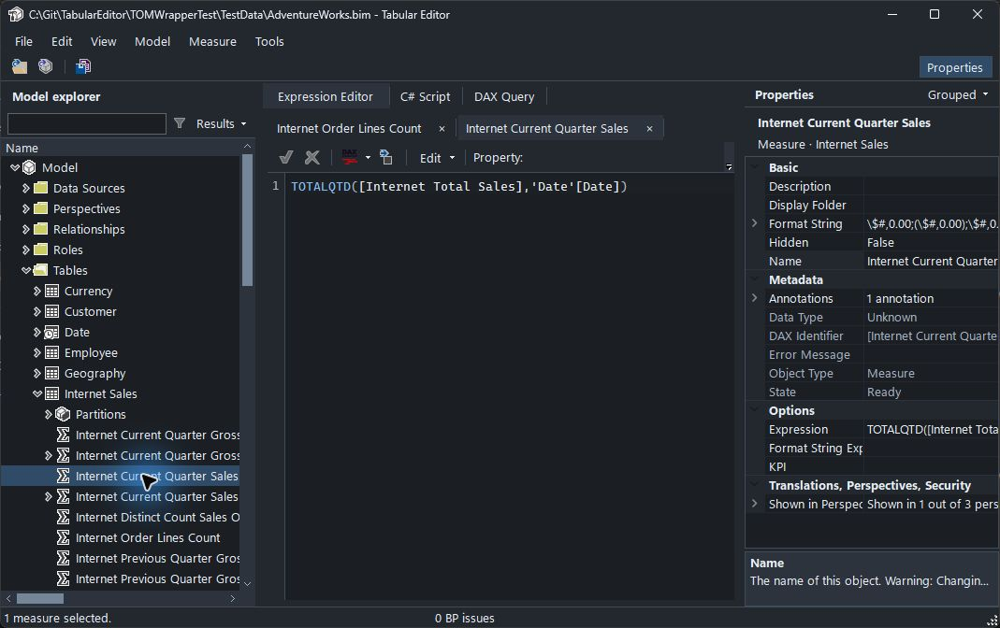

# Tabular Editor 1.0.1

An independent fork of [Tabular Editor 2](https://github.com/TabularEditor/TabularEditor) for editing Power BI and Analysis Services tabular models. This fork adds a tabbed workspace for writing DAX, inspecting query results, and refreshing connected models.

## Download

- [Portable ZIP](https://github.com/WesleyDieterich/TabularEditor/releases/download/v1.0.1/TabularEditor.1.0.1.Portable.zip) — extract the archive and run `TabularEditor.exe`.
- [Windows installer (MSI)](https://github.com/WesleyDieterich/TabularEditor/releases/download/v1.0.1/TabularEditor.1.0.1.Installer.msi)
- [Release notes and SHA-256 checksums](https://github.com/WesleyDieterich/TabularEditor/releases/tag/v1.0.1)

The fork's downloads are unsigned. If a 2.x MSI installation is already present, uninstall it before installing this version with the MSI.

## What's different from official Tabular Editor 2

### DAX Query workspace

Keep multiple DAX scripts open in tabs. Drag tabs to reorder them, double-click to rename, or pin frequently used scripts. Save a tab as a `.dax` file once and subsequent saves update that file. On a connected model, press **F5** to run a query in the background while the editor stays responsive. The results pane shows elapsed time, and **Cancel** lets you stop the query.

### Expression Editor with tabs

Open multiple model expressions and switch between them without losing edits. Tabs support renaming, closing, and saving individually or together. Saving an expression applies it to the model in the editor. Saving the model is a separate action with a confirmation prompt before writing to the server.

### Explore Data and filter results

Right-click a table and choose **Preview Data** to open up to 1,000 rows in **Explore Data**, with one pinnable tab per table. Both **Explore Data** and **DAX Query** use a results grid with automatically sized columns, data-type icons, per-column filters, and Excel export. Filters open in **Basic** mode. **Advanced** date filters include a calendar picker.

### Filter dump measure

Right-click tables, columns, display folders, hierarchies or levels and open **Filter Dump Measure** to generate a measure that reports which columns are directly filtered (`ISFILTERED`) and lists up to 3 of the values each one keeps (change `__MaxValues` in the generated DAX for more). You can **Add to Model** as an undoable measure or **Define in DAX Query** to insert a query-scoped `DEFINE MEASURE` into the active query tab. **(Selection)** uses the columns you selected (Ctrl+click can pick columns from different tables), and a selected table includes all of its columns, hidden and calculation-group columns too. **(All Tables)** covers every table in the model. The measure returns BLANK when nothing is filtered, so it doesn't add rows to visuals.

### Refresh tables and models

On a connected model, right-click a table or the **Model** node and select **Refresh Data**. Choose a refresh type such as **Full**, **Calculate**, or **Only Data**. **Refresh History** shows the target, status, elapsed time, and any error details. **Explore Data** and **Refresh History** are visible while they have content open.

### Workspace and shortcuts

The workspace includes light and dark themes, DAX autocomplete, and a **Properties** panel scoped to the **Expression Editor**. **Ctrl+S** saves the active script or expression when an editor tab is open and otherwise routes to model save. **Ctrl+W** closes the active tab and warns about unsaved edits where applicable.

## Documentation and license

- [Getting Started with Tabular Editor 2](https://docs.tabulareditor.com/te2/Getting-Started.html)
- [Advanced Scripting](https://docs.tabulareditor.com/te2/Advanced-Scripting.html)
- [Official Tabular Editor 2 release history](https://github.com/TabularEditor/TabularEditor/releases)
- [MIT license and original copyright notice](LICENSE)
