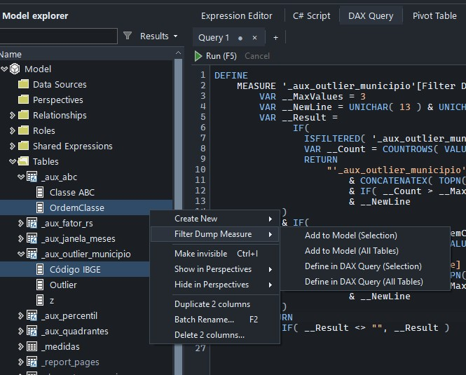
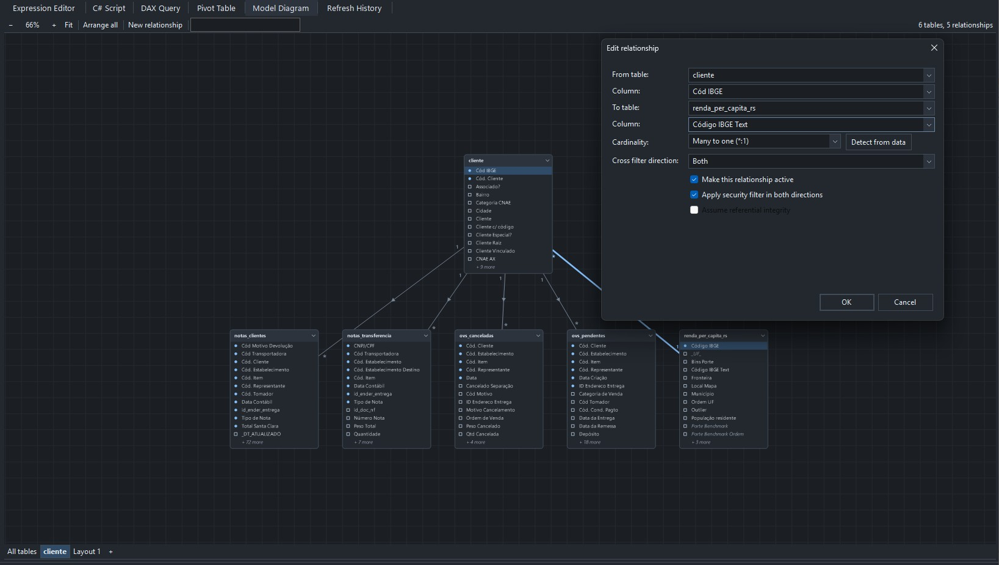

# Tabular Editor 1.0.1

An independent fork of [Tabular Editor 2](https://github.com/TabularEditor/TabularEditor) for editing Power BI and Analysis Services tabular models. This fork adds a tabbed workspace for writing DAX, inspecting query results, editing relationships in a model diagram, and refreshing connected models.

## Download

- [Portable ZIP](https://github.com/WesleyDieterich/TabularEditor/releases/download/v1.0.1/TabularEditor.1.0.1.Portable.zip) — extract the archive and run `TabularEditor.exe`.
- [Windows installer (MSI)](https://github.com/WesleyDieterich/TabularEditor/releases/download/v1.0.1/TabularEditor.1.0.1.Installer.msi)
- [Release notes and SHA-256 checksums](https://github.com/WesleyDieterich/TabularEditor/releases/tag/v1.0.1)

The fork's downloads are unsigned. If a 2.x MSI installation is already present, uninstall it before installing this version with the MSI.

## What's different from official Tabular Editor 2

### DAX Query workspace

Keep multiple DAX scripts open in tabs. Drag tabs to reorder them, double-click to rename, or pin frequently used scripts. Save a tab as a `.dax` file once and subsequent saves update that file. On a connected model, press **F5** to run a query in the background while the editor stays responsive. The results pane shows elapsed time, and **Cancel** lets you stop the query.

### Expression Editor with tabs

Open multiple model expressions and switch between them without losing edits. Tabs support renaming, closing, and saving individually or together. Saving an expression applies it to the model in the editor. Saving the model is a separate action with a confirmation prompt before writing to the server.

### Explore Data and filter results

Right-click a table and choose **Preview Data** to open up to 1,000 rows in **Explore Data**, with one pinnable tab per table. Both **Explore Data** and **DAX Query** use a results grid with automatically sized columns, data-type icons, per-column filters, and Excel export. Filters open in **Basic** mode. **Advanced** date filters include a calendar picker.

### Filter dump measure

Right-click tables, columns, display folders, hierarchies or levels and open **Filter Dump Measure** to generate a measure that reports which columns are directly filtered (`ISFILTERED`) and lists up to 3 of the values each one keeps (change `__MaxValues` in the generated DAX for more). You can **Add to Model** as an undoable measure or **Define in DAX Query** to insert a query-scoped `DEFINE MEASURE` into the active query tab. **(Selection)** uses the columns you selected (Ctrl+click can pick columns from different tables), and a selected table includes all of its columns, hidden and calculation-group columns too. **(All Tables)** covers every table in the model. The measure returns BLANK when nothing is filtered, so it doesn't add rows to visuals.

### Model Diagram

The **Model Diagram** tab draws tables as cards and relationships as lines, similar to the model view in Power BI Desktop. Relationship columns are pinned to the top of each card. **All tables** shows the whole model. Custom layouts hold only the tables you add, either by dragging them from the model tree or with **Add related tables**. You can select several cards with Ctrl+click or a Shift+drag box, then move, resize, or collapse them. Layouts and card sizes are saved per model.

Drag a column onto a column in another table to create a relationship, or double-click a line to edit one. The relationship dialog sets cardinality, cross filter direction, active state and security filtering. On a connected model, **Detect from data** sets cardinality from the data. OK is blocked, with an explanation, when a change would create ambiguous filter paths, mismatched data types, or duplicate relationships. Each create, edit, or delete is a single undo step.

### Refresh tables and models

On a connected model, right-click a table or the **Model** node and select **Refresh Data**. Choose a refresh type such as **Full**, **Calculate**, or **Only Data**. **Refresh History** shows the target, status, elapsed time, and any error details. **Explore Data** and **Refresh History** are visible while they have content open.

### Workspace and shortcuts

The workspace includes light and dark themes, DAX autocomplete, and a **Properties** panel scoped to the **Expression Editor**. **Ctrl+S** saves the active script when a DAX query or C# script editor has focus; in the Expression Editor it applies the active expression to the model and then saves the model; elsewhere it saves the model, and the save confirmation warns when expression tabs still hold unapplied edits. **Ctrl+Shift+S** (File > Save all) applies every expression tab's edits and then saves the model. **Ctrl+W** closes the active tab and warns about unsaved edits where applicable.

### Color previews in DAX

Hex colors in DAX strings (`"#2B8A3E"`, `"#ABC"`, `"#1C7ED680"`, or inside SVG markup like `fill='#F59F00'`) are shown on a chip of their own color in the **DAX Query** and **Expression Editor**. **Ctrl+click** a color to open a color picker with a saturation/brightness square, a hue bar, and an opacity bar for 8-digit colors. The text updates as you pick and keeps its letter case and length. Click the original color on the right of the header to go back to it, press **Esc** to cancel, or press **Enter** or click elsewhere to keep it. A whole picker session undoes in one step. Turn the previews off under **Preferences > DAX > Editing**.

## Documentation and license

- [Getting Started with Tabular Editor 2](https://docs.tabulareditor.com/te2/Getting-Started.html)
- [Advanced Scripting](https://docs.tabulareditor.com/te2/Advanced-Scripting.html)
- [Official Tabular Editor 2 release history](https://github.com/TabularEditor/TabularEditor/releases)
- [MIT license and original copyright notice](LICENSE)
